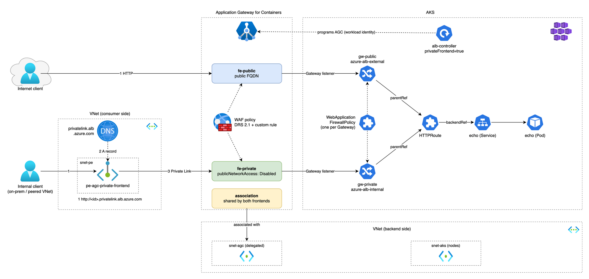

# AGC private frontend demo

Tests the Application Gateway for Containers (AGC) private frontend on AKS with OpenTofu: a public and a private frontend on one AGC, a private endpoint with private DNS, and WAF per Gateway. Blog post: [link to post]



Lab test, not production guidance. Destroy after use (`tofu destroy`).

## Layout
- `infra/` - VNet, AKS (1 node, Azure CNI overlay, Free tier), ALB controller (Helm, workload identity), AGC (AzAPI, API 2026-03-01), public and private frontend, private endpoint, private DNS zone, WAF policies.
- `manifests/` - sample app, public and private Gateway and HTTPRoute, WAF policies (`AGC_ID` is substituted with `sed`).

## Run
```
cd infra
cp ../example.tfvars terraform.tfvars   # set subscription_id
tofu init && tofu apply
az aks get-credentials -g <rg> -n <aks> --file ../kubeconfig
export KUBECONFIG=../kubeconfig
kubectl apply -f ../manifests/00-app.yaml
sed "s#AGC_ID#$(tofu output -raw agc_id)#" ../manifests/10-gateway-public.yaml | kubectl apply -f -
sed "s#AGC_ID#$(tofu output -raw agc_id)#" ../manifests/20-gateway-private.yaml | kubectl apply -f -
kubectl apply -f ../manifests/30-waf.yaml
```

The private frontend needs the ALB controller Helm value `albController.privateFrontend=true`. That creates the `azure-alb-internal` GatewayClass.
